<div align="center">

# Parallel Instance Decoding for Language-Guided Localization in Aerial Images

<p align="center">
  
</p>

[Shubham Patle](https://github.com/shubhamrpatle)<sup>1</sup> · Muhammad Zaigham Zaheer<sup>1</sup> · Mustansar Fiaz<sup>2</sup> · [Hanoona Abdul Rasheed](https://github.com/hanoonaR)<sup>1</sup> · [Fahad Shahbaz Khan](https://sites.google.com/view/fahadkhans/home)<sup>1</sup> · [Salman Khan](https://salman-h-khan.github.io/)<sup>1</sup>

<sup>1</sup> Mohamed bin Zayed University of Artificial Intelligence · <sup>2</sup> International Business Machines (IBM)

[-blue)](#-citation)
[](https://huggingface.co/datasets/shubhampatle/Pixel-PIVR-Magnified-v2/tree/591d53da15234597941394f2848740151209434b/refwave_v6_xview_corrected_20260914)
[](LICENSE)

</div>

## 📝 Abstract

Localization in Earth observation is challenging because aerial scenes are large, objects vary greatly in scale, and the number of targets changes from image to image. Existing remote-sensing vision-language models localize by generating bounding-box coordinates autoregressively, so decoding slows down as the object count grows and each box depends on the boxes before it. We introduce **Parallel Instance Decoding (PID)**, a unified generative localization framework that separates instance identification from spatial localization. Given a textual reference (a class name or phrase), PID first generates one point address per matching instance and then predicts the boxes of all instances in a single parallel pass, using an instance-isolated attention mask. Under the same training data and setup, PID improves F1@0.50 over the direct-box baseline by 8.3 points on DIOR and 7.3 points on DOTAv2, and reduces complete-response latency by 22.4% and 43.6%, respectively.

<p align="center">
  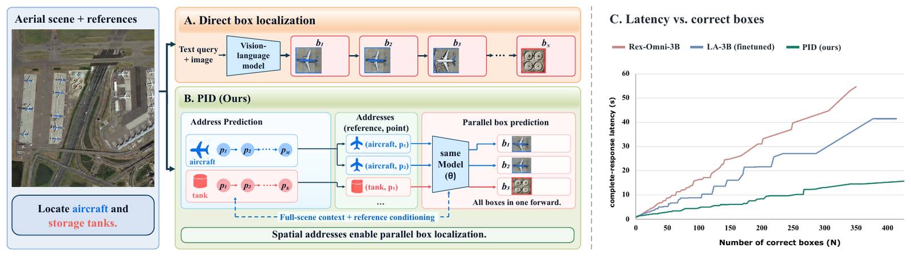
</p>

**Parallel Instance Decoding (PID).** **(A)** Direct box localization decodes boxes sequentially, even when coordinates within a box are predicted in parallel. **(B)** PID first predicts one point address per object instance for each textual reference (e.g., class name), and then predicts the boxes of all addresses in a single parallel pass using instance-isolated attention. **(C)** Complete-response latency on DOTAv2 versus the number of correctly predicted boxes per image. The latency of direct-box models grows steeply as images contain more objects, whereas PID's latency grows much more slowly, because all boxes are predicted in one parallel pass.

## 🔥 Contributions

- **Point-addressed localization.** PID separates *which* object instances should be localized from *where* their boxes should be placed. The model first predicts a point address for each referred object and then predicts one box conditioned on each address.
- **Parallel address-conditioned box prediction.** A single model predicts both the point addresses and their boxes. With instance-isolated attention, each box depends only on the image, its reference and its own address, so all boxes are predicted in one parallel pass.
- **Accuracy and decoding efficiency.** Under the same data, training curriculum and trainable components, PID outperforms the direct-box baseline by 8.3 F1@0.50 points on DIOR and 7.3 points on DOTAv2, and reduces complete-response latency by 22.4% on DIOR and 43.6% on DOTAv2, with a larger advantage in the denser DOTAv2 scenes.

## 🛠️ Using the Code

| Component | Location |
| --- | --- |
| Install the environment | [Installation guide](INSTALL.md) |
| Download LocateAnything-3B, the images and the training records | [Training guide, step 2](docs/TRAINING.md#2-download-the-model-and-data) |
| Train PID and the direct-box baselines (LoRA or full fine-tuning, 1–8 GPUs, SLURM) | [Training guide](docs/TRAINING.md), [`train_full.sh`](train_full.sh), [`train_lora.sh`](train_lora.sh), [`cluster.slurm`](cluster.slurm) |
| Generate predictions from a trained checkpoint | [Evaluation guide](docs/EVALUATION.md) and [`evaluate.sh`](evaluate.sh) |
| Score detection, grounding, pointing and efficiency under the paper's protocol | [`paper_evaluation/`](paper_evaluation/README.md) |
| Data hashes, training settings and the checks that were run | [Reproducibility notes](docs/REPRODUCIBILITY.md) and [`VERIFICATION.md`](VERIFICATION.md) |

The method identifier in commands and file names is `refwave`, the project's working name; read it as PID. The direct-box baselines are `METHOD=standard` (LA-3B (FT)) and `METHOD=class_isolated` (LA-3B (FT, class-iso.)). See [Naming](docs/REPRODUCIBILITY.md#naming).

### 🚀 Quick Start

After [installing the environment](INSTALL.md) and [downloading the model and data](docs/TRAINING.md#2-download-the-model-and-data), train PID with the paper's setting (eight GPUs, two epochs per stage) and generate validation predictions:

```bash
export WORK_ROOT=/scratch/$USER/refwave-assets
export DATA_ROOT="$WORK_ROOT/dataset"
export RECORDS_DIR="$DATA_ROOT/refwave_v6_xview_corrected_20260914"
export EVAL_RECORDS="$RECORDS_DIR/validation.jsonl"

METHOD=refwave STAGE1_EPOCHS=2 STAGE2_EPOCHS=2 bash train_full.sh 8 both

RUN_ROOT="/absolute/path/to/the/refwave/run"  # Printed when training starts.
bash evaluate.sh 4 "$RUN_ROOT/stage2/best.pt"
```

`evaluate.sh` scores the 747 validation queries. The benchmark numbers in the paper come from [`paper_evaluation/`](paper_evaluation/README.md).

## 💡 Parallel Instance Decoding

<p align="center">
  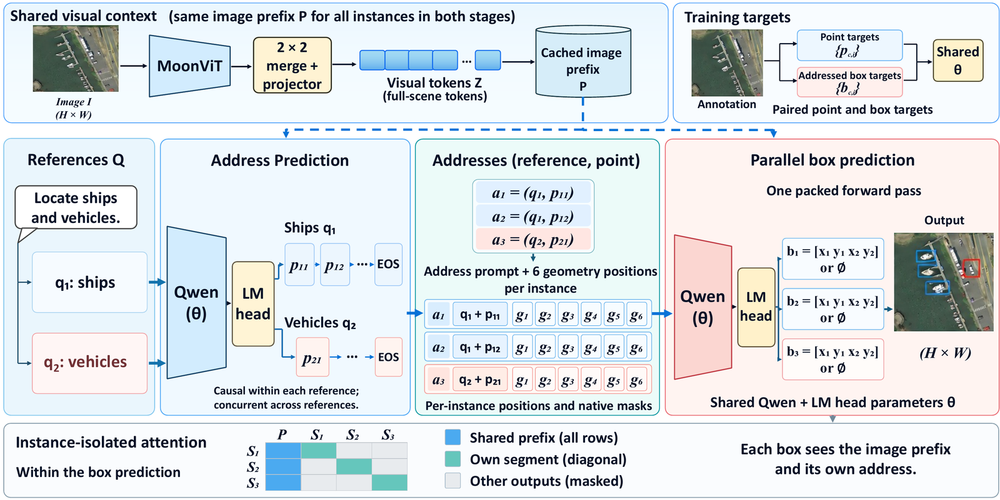
</p>

**PID overview.** The model first proposes reference-conditioned address points and then predicts one horizontal bounding box per address. A shared image prefix provides global context, and masking prevents each address-conditioned box prediction from depending on other predicted boxes, enabling parallel decoding.

## 📊 Main Results

### 🎯 Category-conditioned detection

<p align="center">
  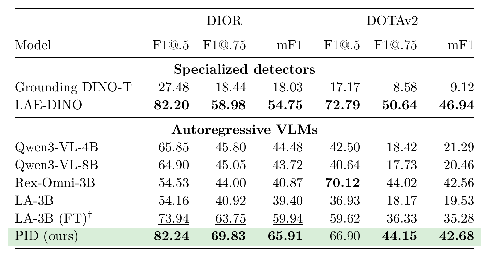
</p>

**Table 1: Category-conditioned horizontal bounding-box detection** under annotated-category queries. mF1 is the mean F1 over ten IoU thresholds (0.50–0.95). Bold: best; underline: second best. † indicates our fine-tuned variant.

### 📍 Grounding and pointing

<p align="center">
  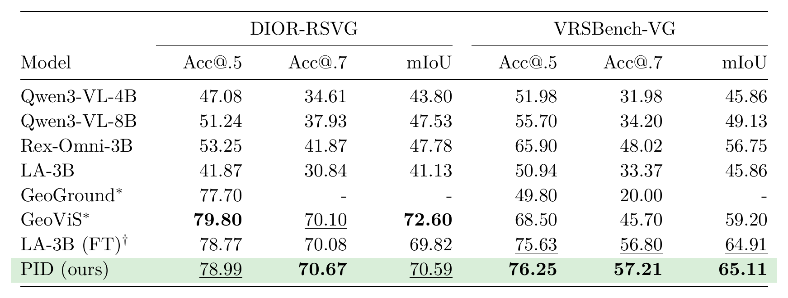
</p>

**Table 2: Single-target referring-expression grounding** on DIOR-RSVG and VRSBench-VG (Acc@0.5, Acc@0.7 and mean IoU). * indicates results reported in prior work.

<p align="center">
  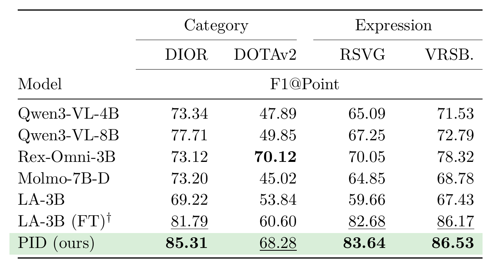
</p>

**Table 3: Pointing (F1)** for category-conditioned (DIOR, DOTAv2) and expression-conditioned (DIOR-RSVG, VRSBench-VG) queries.

### ⚡ Inference efficiency

<p align="center">
  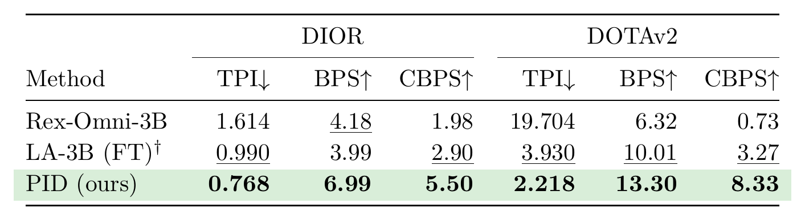
</p>

**Table 4: Complete-response detection efficiency.** TPI: seconds per image; BPS/CBPS: valid / correctly matched boxes per second (IoU 0.50 for correctness), reported per worker.

<p align="center">
  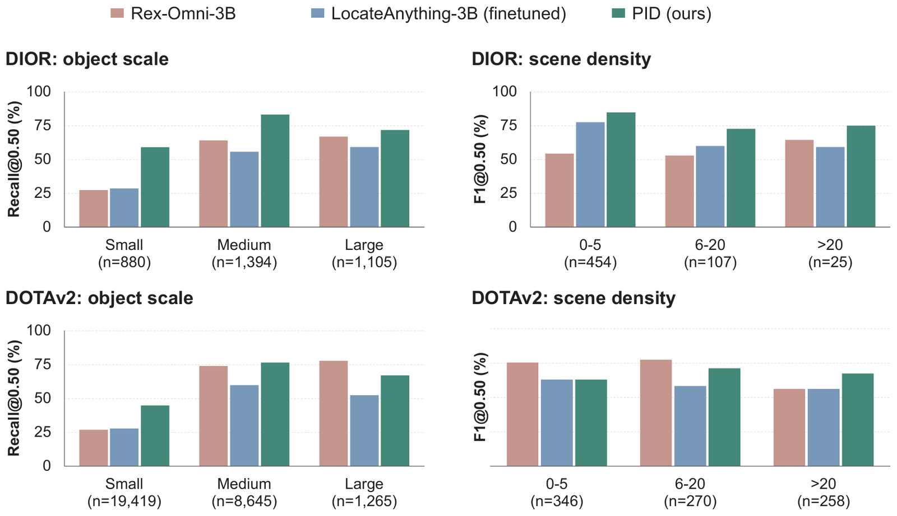
</p>

**Performance by object scale and scene density.** Left: recall at IoU 0.50 by ground-truth box area relative to the image. Right: F1@0.50 within each scene-density bin.

### 🔬 Ablation studies

<p align="center">
  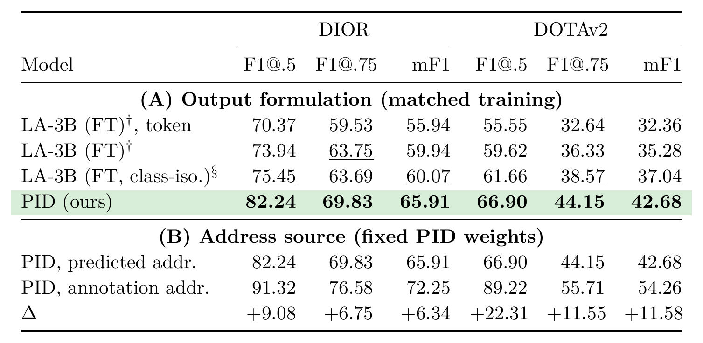
</p>

**Table 5: Ablation of instance-addressed localization.** (A) Output formulations under matched training; "token" decodes every coordinate token by token with the same weights. (B) PID with predicted versus annotation-derived addresses using the same weights.

<p align="center">
  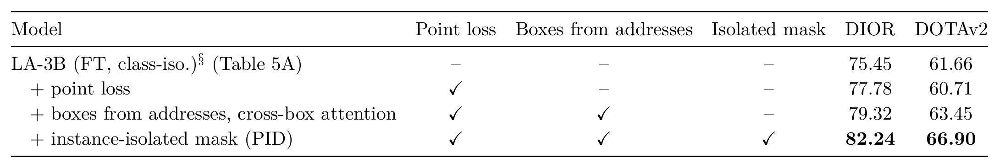
</p>

**Table 6: Cumulative component ablation (F1@0.50).** Starting from the class-isolated direct-box model, we add the point loss of PID, the prediction of boxes from addresses (with cross-box attention to the other addresses), and the instance-isolated mask.

## 👀 Qualitative Results

<p align="center">
  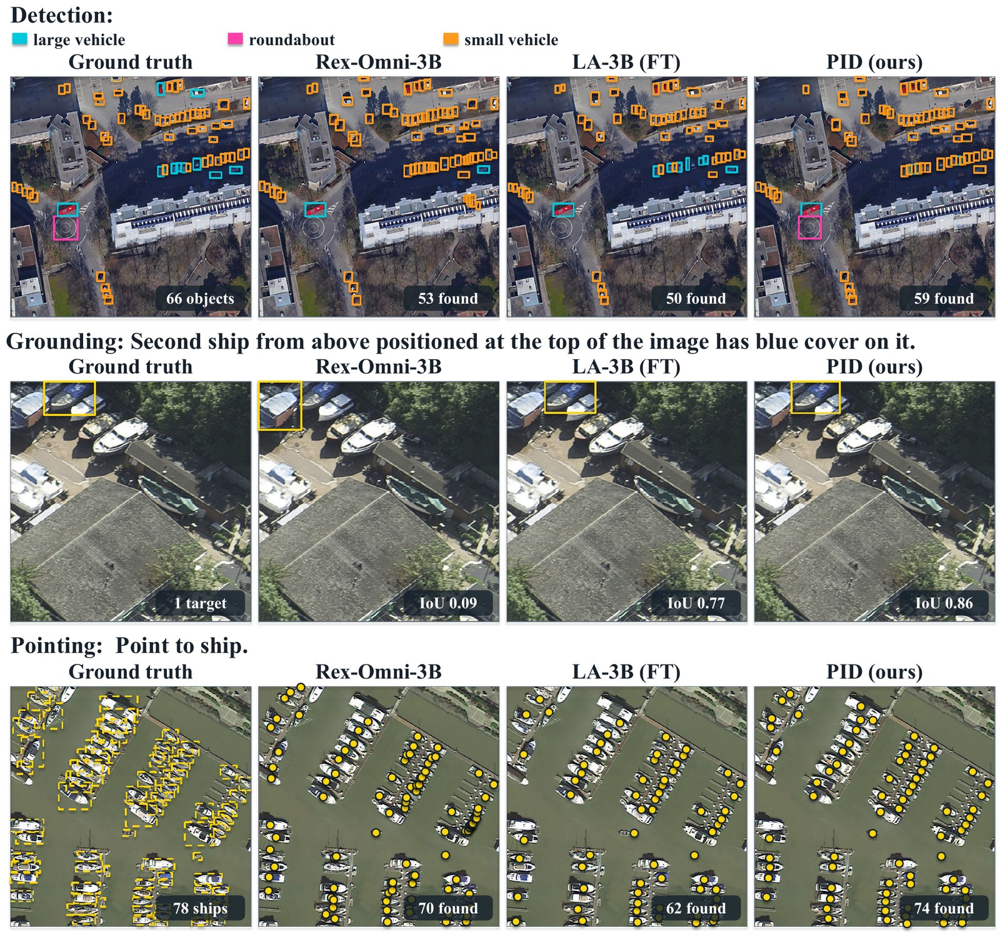
</p>

**Detection (top; DOTAv2), grounding (middle; VRSBench-VG) and pointing (bottom; DOTAv2)** for ground truth, Rex-Omni-3B, LA-3B (FT)† and PID. Colors denote detection categories; dashed boxes and dots denote pointing targets and predictions. Labels show counts or grounding IoU.

<p align="center">
  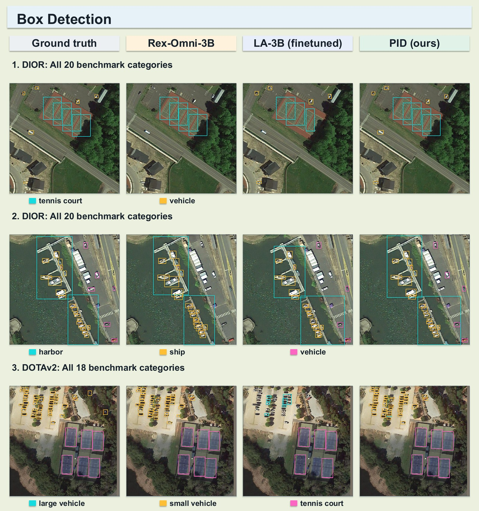
</p>

**Full-vocabulary detection** on DIOR and DOTAv2, with all benchmark categories requested.

<p align="center">
  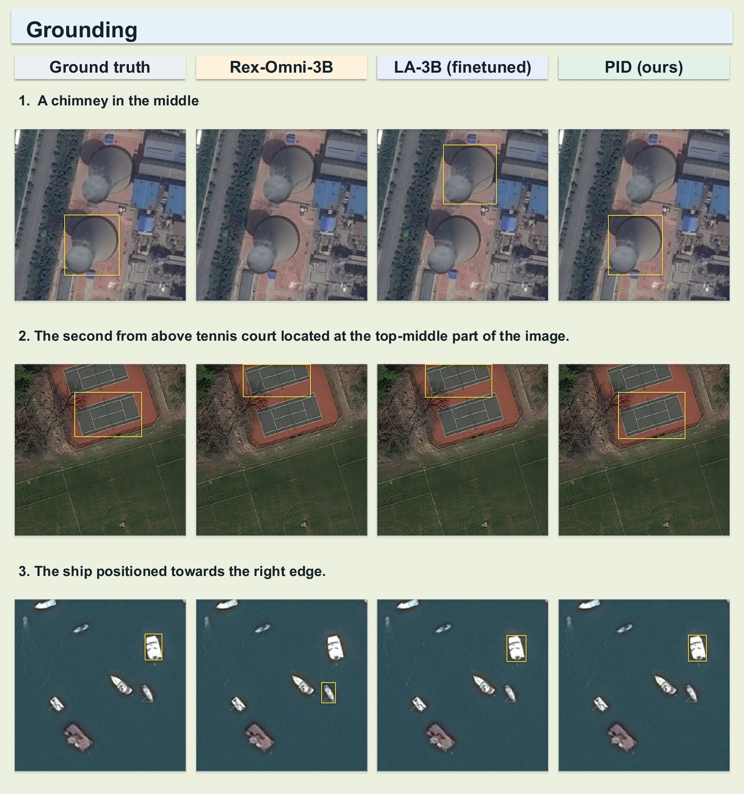
</p>

**Referring-expression grounding** on DIOR-RSVG and VRSBench-VG.

<p align="center">
  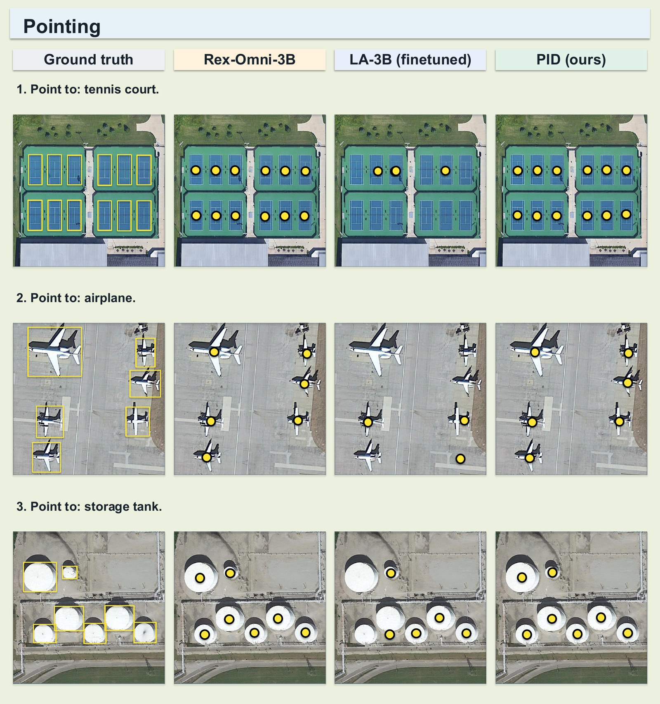
</p>

**Category-conditioned pointing** on DIOR: tennis courts, aircraft and storage tanks.

## 🙏 Acknowledgements

PID is built on [LocateAnything](https://github.com/NVlabs/Eagle/tree/main/Embodied) and initialized from the released [LocateAnything-3B](https://huggingface.co/nvidia/LocateAnything-3B) checkpoint. We thank its authors for making their work and implementation publicly available. `src/refwave/native_mtp.py` derives from NVlabs/Eagle under Apache-2.0; see [THIRD_PARTY.md](THIRD_PARTY.md).

## 📄 License

Apache-2.0, see [LICENSE](LICENSE). Third-party attribution is in [THIRD_PARTY.md](THIRD_PARTY.md). Model weights and datasets retain their own separate licenses and use conditions.

## 📜 Citation

The arXiv identifier will be added here once the paper is public.

```bibtex
@misc{patle2026pid,
  title  = {Parallel Instance Decoding for Language-Guided Localization in Aerial Images},
  author = {Patle, Shubham and Zaheer, Muhammad Zaigham and Fiaz, Mustansar and Rasheed, Hanoona Abdul and Khan, Fahad Shahbaz and Khan, Salman},
  year   = {2026}
}
```

---

<p align="center">
  <a href="https://www.ival-mbzuai.net">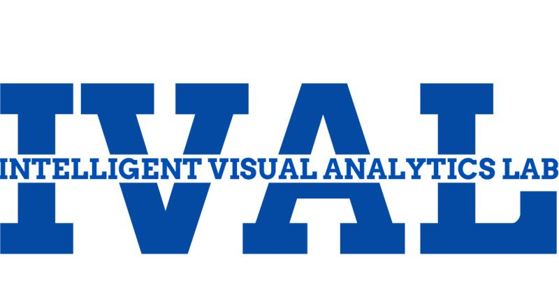</a>
  &nbsp;&nbsp;&nbsp;&nbsp;
  <a href="https://github.com/mbzuai-oryx">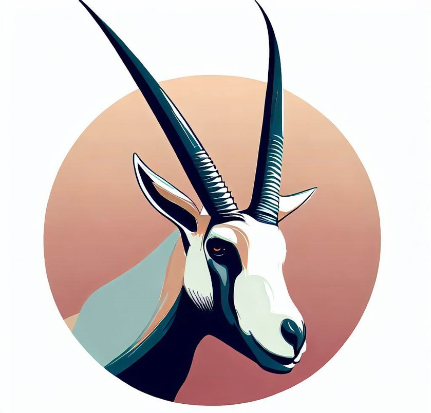</a>
  &nbsp;&nbsp;&nbsp;&nbsp;
  <a href="https://mbzuai.ac.ae">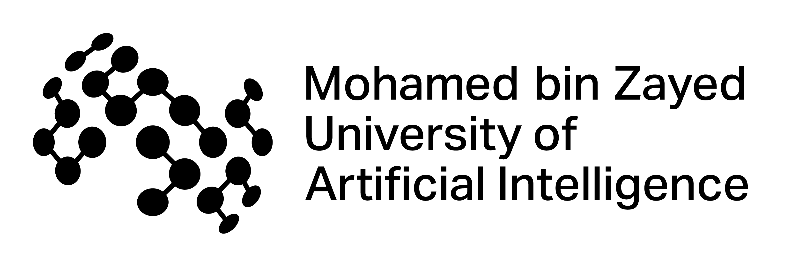</a>
</p>
